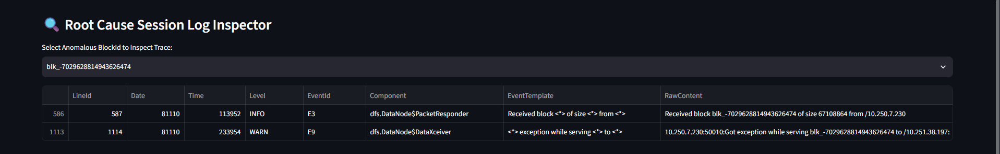

# Intelligent System Log Parsing & Anomaly Detection (AIOps)

An automated AIOps pipeline designed to parse unstructured enterprise system logs using **Drain3** and detect session anomalies proactively using unsupervised **Isolation Forest** machine learning.

## 🚀 Project Overview
In large-scale cloud and telecommunications infrastructures (such as Huawei Cloud or 5G Core networks), manually tracking millions of raw log lines is impossible. This project automates the entire Observability & AIOps pipeline:
1. **Log Parsing:** Extracts raw log messages and groups them into structured templates using Drain3.
2. **Feature Engineering:** Aggregates event counts per unique transaction session (`BlockId`) into a machine learning feature matrix.
3. **Anomaly Detection:** Flags abnormal system behavior using Isolation Forest.
4. **Operational Dashboard:** Provides an interactive Streamlit UI for SRE teams to inspect root causes.

## 🛠️ Tech Stack & Libraries
* **Language:** Python 3.12+
* **Log Parsing:** Drain3
* **Machine Learning:** Scikit-Learn (Isolation Forest)
* **Data Processing:** Pandas, NumPy
* **Visualization & UI:** Plotly, Streamlit
* **Testing:** Pytest

## 📂 Project Structure
AIOps-Log-Anomaly-Detection/
│
├── data/
│   └── HDFS_2k.log
│
├── models/
│   └── isolation_forest_hdfs.pkl
│
├── src/
│   ├── __init__.py
│   ├── log_parser.py
│   ├── feature_engineering.py
│   └── train_detector.py
│
├── test/
│   ├── __init__.py
│   └── test_pipeline.py
│
├── app.py
├── main.py
├── requirements.txt
└── README.md

## ⚙️ How to Run Locally
1. Clone the repository:
   ```bash
   git clone [https://github.com/Yazzar21/AIOps-Log-Anomaly-Detection.git](https://github.com/Yazzar21/AIOps-Log-Anomaly-Detection.git)
   cd AIOps-Log-Anomaly-Detection
   ```
   a. Create and activate a virtual environment:
   ```bash
   python -m venv venv
   venv\Scripts\activate
   ```
   b. Install dependencies:
   ```bash
   pip install -r requirements.txt
   ```
   c. Run the data pipeline:
   ```bash
   python main.py
   ```
   d. Launch the Streamlit Dashboard:
   ```bash
   streamlit run app.py
   ```
## 📊 Dashboard Preview & Results

Below is a screenshot of the Streamlit web interface, showing the log monitoring and anomaly detection system running in real-time:

### 1. System Overview & Anomaly Distribution
The main dashboard displays summary metrics (total number of logs, templates isolated by Drain3, total block sessions, and the rate of detected anomalies), along with a score distribution chart and the top log templates.


### 2. Root Cause Session Log Inspector
Interactive features for Site Reliability Engineers (SREs) to conduct in-depth exploration of raw log traces based on a `BlockId` flagged for anomalies, for the purpose of troubleshooting.



Analysis: The interactive Streamlit UI offers operational metrics, anomaly score distribution histograms, top mined log templates, and a Root Cause Session Log Inspector.
